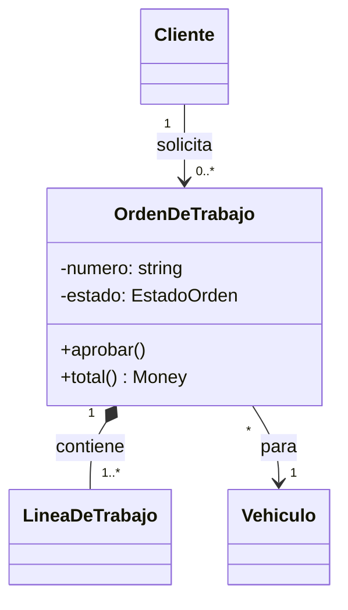
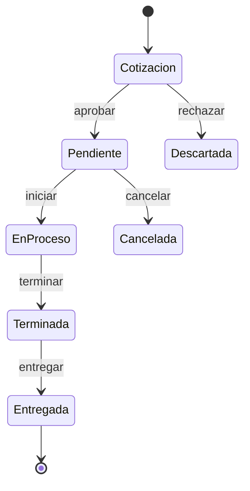

## Objetivo

Saber modelar un sistema con orientación a objetos y leer y dibujar los diagramas UML más útiles: casos de uso (con su descripción), clases con cardinalidad, secuencia, transición de estados y actividades, y usarlos como herramienta de pensamiento y comunicación, no como burocracia.

## Estudio

### Del análisis estructurado al orientado a objetos

En la sesión anterior separaste **datos** (almacenes, flujos) de **procesos**. El análisis orientado a objetos (O-O) los combina: un **objeto** representa una persona, cosa, transacción o evento real y contiene tanto sus datos como los procesos que actúan sobre ellos. Los analistas suelen usar ambos enfoques: DFD para ver flujos de información entre áreas y modelos de objetos para el diseño del software.

### Vocabulario O-O del analista

| Concepto | Qué es | Ejemplo en un taller mecánico |
| --- | --- | --- |
| **Objeto** | Una instancia concreta con datos y comportamiento. | El auto de placa ABC-123. |
| **Atributo** | Una característica del objeto (como un adjetivo). Su valor actual es su **estado**. | marca, modelo, kilometraje; estado: "en reparación". |
| **Método** | Una tarea que el objeto sabe hacer (como un verbo). | `programarServicio()`, `registrarKilometraje()`. |
| **Mensaje** | Una orden que un objeto envía a otro para que ejecute un método. | La orden de trabajo envía `asignar(mecánico)`. |
| **Clase** | La plantilla de un grupo de objetos con los mismos atributos y métodos. | `Vehiculo`. |
| **Instancia** | Un objeto concreto de una clase. | El auto ABC-123 es una instancia de `Vehiculo`. |
| **Herencia** | Una subclase hereda atributos y métodos de su superclase. | `Camion` y `Moto` heredan de `Vehiculo`. |
| **Encapsulamiento** | Los datos y la implementación internos están ocultos; solo se accede mediante mensajes. | Nadie cambia el kilometraje directamente; se envía un mensaje. |
| **Polimorfismo** | El mismo mensaje produce comportamientos distintos según el objeto que lo recibe. | `calcularMantenimiento()` es distinto para un camión y una moto. |

El libro lo explica con un ejemplo cotidiano: un empleado de comida rápida que prepara papas fritas recibe el mensaje "papas grandes" y sabe exactamente qué hacer; el cajero no necesita saber cómo se fríen. Eso es encapsulamiento: el mensaje dice **qué**, el objeto decide **cómo**.

Ya conoces estas ideas desde la sesión 2 y el bloque de patrones, donde viste también sus matices: la herencia es la relación más fuerte y conviene preferir la composición; el polimorfismo es la herramienta para invertir dependencias.

### Relaciones entre objetos y clases

Las relaciones permiten que los objetos se comuniquen y colaboren. Las más comunes:

- **Herencia ("es un")**: `Instructor` es un `Empleado`, que es una `Persona`.
- **Asociación ("tiene", "usa", "pertenece a")**: un `Cliente` hace muchos `Pedidos`.
- **Agregación y composición ("es parte de")**: un `Pedido` contiene `LineasDePedido`. En la composición, las partes no existen sin el todo (si borras el pedido, sus líneas desaparecen).

### UML: un lenguaje común

El **Lenguaje Unificado de Modelado (UML)** es una notación estándar para modelar sistemas orientados a objetos. No es una metodología: es un vocabulario visual. Igual que los nombres de patrones, su valor está en que otro desarrollador entienda tu diagrama sin explicaciones.

### Diagramas de casos de uso

Un **caso de uso** representa los pasos de una función o proceso del sistema, visto desde fuera. Un **actor** (una persona, organización o sistema externo, dibujado como un monigote con su rol) inicia el caso de uso pidiendo al sistema que haga algo.

```
                 ┌──────────── Sistema de taller ─────────────┐
                 │                                             │
   O             │   ( Agendar cita )                          │
  /|\  ──────────┼──▶                                          │
  / \  Cliente   │   ( Consultar estado del vehículo )         │
                 │                                             │
   O             │   ( Crear orden de trabajo ) ──«include»──▶ ( Verificar historial )
  /|\  ──────────┼──▶                                          │
  / \  Asesor    │   ( Facturar servicio ) ◀──«extend»── ( Aplicar garantía )
                 │                                             │
   O             │   ( Registrar trabajo realizado )           │
  /|\  ──────────┼──▶                                          │
  / \  Mecánico  └─────────────────────────────────────────────┘
```

- La línea entre un actor y un caso de uso es una **asociación**.
- **«include»** (el libro lo llama relación *uses*): un caso de uso **siempre** utiliza a otro (crear una orden siempre verifica el historial). Sirve para no repetir pasos comunes.
- **«extend»**: un caso de uso agrega comportamiento a otro **solo bajo ciertas condiciones** (facturar se extiende con la garantía si el trabajo está cubierto).

El diagrama solo da el mapa. El valor real está en la **descripción del caso de uso**, que el libro recomienda documentar así:

| Campo | Ejemplo: Crear orden de trabajo |
| --- | --- |
| Nombre | Crear orden de trabajo |
| Actor | Asesor de servicio |
| Descripción | Registra un vehículo que ingresa al taller y los trabajos solicitados. |
| Disparador | El cliente llega con su vehículo. |
| Precondición | El cliente y el vehículo están registrados. |
| Pasos | 1. El asesor busca el vehículo por placa. 2. El sistema muestra el historial. 3. El asesor registra kilometraje y trabajos solicitados. 4. El sistema calcula un presupuesto estimado. 5. El cliente aprueba. 6. El sistema genera la orden y la asigna a la cola del taller. |
| Postcondición | Existe una orden en estado "pendiente" con presupuesto aprobado. |
| Flujos alternativos | 5a. El cliente no aprueba: la orden se guarda como "cotización" y no entra en la cola. |

Una descripción así es casi un test de aceptación: precondición → *Dado*, disparador y pasos → *Cuando*, postcondición → *Entonces*.

### Diagramas de clases

Un **diagrama de clases** muestra las clases de objetos y sus relaciones en un caso de uso o en todo el sistema. Cada clase es un rectángulo con tres compartimentos: nombre, atributos y métodos. Es un **modelo lógico** que evoluciona hacia el físico y finalmente hacia el código.

```
┌──────────────────────┐ 1      0..* ┌────────────────────────┐ 1     1..* ┌──────────────────────┐
│ Cliente              │─────────────│ OrdenDeTrabajo          │◆───────────│ LineaDeTrabajo        │
├──────────────────────┤  solicita   ├────────────────────────┤  contiene  ├──────────────────────┤
│ - id: ClienteId      │             │ - numero: string        │            │ - descripcion: string │
│ - nombre: string     │             │ - estado: EstadoOrden   │            │ - horas: number       │
│ - telefono: string   │             │ - kilometraje: number   │            │ - tarifa: Money       │
├──────────────────────┤             ├────────────────────────┤            ├──────────────────────┤
│ + vehiculos()        │             │ + aprobar()             │            │ + subtotal(): Money   │
└──────────────────────┘             │ + total(): Money        │            └──────────────────────┘
                                     └───────────┬────────────┘
                                                 │ * para 1
                                     ┌───────────┴────────────┐
                                     │ Vehiculo               │
                                     └────────────────────────┘
```

#### Cardinalidad (multiplicidad)

La **cardinalidad** describe cuántas instancias de una clase se relacionan con cuántas de otra. Las notaciones más comunes:

| Notación | Significado | Ejemplo |
| --- | --- | --- |
| `1` | Exactamente uno | Cada orden pertenece a exactamente un vehículo. |
| `0..1` | Cero o uno | Un empleado tiene cero o un vehículo asignado. |
| `0..*` | Cero o muchos | Un cliente puede tener cero o muchas órdenes. |
| `1..*` | Uno o muchos | Una orden tiene al menos una línea de trabajo. |

La cardinalidad no es un detalle gráfico: **codifica reglas de negocio**. "Una orden tiene al menos una línea" es una regla que debe cumplirse en el código y que verás como **invariante de un agregado** en DDD (sesión 25).

#### De diagrama a TypeScript

```ts
type EstadoOrden = "cotizacion" | "pendiente" | "en_proceso" | "terminada" | "entregada";

class LineaDeTrabajo {
  constructor(readonly descripcion: string, readonly horas: number, readonly tarifa: number) {
    if (horas <= 0) throw new Error("Las horas deben ser positivas");
  }
  subtotal() { return this.horas * this.tarifa; }
}

class OrdenDeTrabajo {
  private estado: EstadoOrden = "cotizacion";
  private readonly lineas: LineaDeTrabajo[];
  constructor(readonly numero: string, readonly vehiculoId: string, lineas: LineaDeTrabajo[]) {
    if (lineas.length === 0) throw new Error("Una orden tiene al menos una línea"); // 1..*
    this.lineas = [...lineas];
  }
  aprobar() {
    if (this.estado !== "cotizacion") throw new Error("Solo se aprueban cotizaciones");
    this.estado = "pendiente";
  }
  total() { return this.lineas.reduce((s, l) => s + l.subtotal(), 0); }
  get estadoActual() { return this.estado; }
}
```

### Diagramas de secuencia

Un **diagrama de secuencia** muestra cómo interactúan los objetos **a lo largo del tiempo** para completar un caso de uso. Sus elementos:

- **Clases u objetos**: rectángulos en la parte superior.
- **Líneas de vida**: líneas verticales punteadas que representan el tiempo que existe el objeto.
- **Mensajes**: flechas horizontales de un objeto a otro, en orden de arriba abajo.
- **Foco de control (activación)**: rectángulos estrechos sobre la línea de vida que indican cuándo el objeto está ejecutando algo.

```
 Asesor        :OrdenController     :CrearOrden        :VehiculoRepo     :OrdenRepo
   │                 │                   │                   │                │
   │ crear(placa,..) │                   │                   │                │
   │────────────────▶│ ejecutar(cmd)     │                   │                │
   │                 │──────────────────▶│ buscarPorPlaca()  │                │
   │                 │                   │──────────────────▶│                │
   │                 │                   │◀ ─ ─ vehiculo ─ ─ │                │
   │                 │                   │ new OrdenDeTrabajo│                │
   │                 │                   │───┐               │                │
   │                 │                   │◀──┘               │                │
   │                 │                   │ guardar(orden)                     │
   │                 │                   │───────────────────────────────────▶│
   │                 │◀ ─ ─ ordenId ─ ─ ─│                   │                │
   │◀ ─ 201 Created ─│                   │                   │                │
```

Los diagramas de secuencia son excelentes para **diseñar y revisar** un caso de uso antes de programarlo: revelan objetos que hablan con demasiados otros (falta un mediador o una fachada), responsabilidades mal ubicadas (el controlador hace cálculos de negocio) y dependencias en la dirección equivocada.

### Diagramas de transición de estados

Muestran cómo un objeto cambia de estado en respuesta a eventos. Los estados son rectángulos redondeados, las flechas son transiciones etiquetadas con el evento que las dispara, un círculo relleno marca el estado inicial y uno con borde, el final.

```
  ●──▶ (Cotización) ──aprobar──▶ (Pendiente) ──iniciar──▶ (En proceso) ──terminar──▶ (Terminada)
            │                        │                                                  │
            │ rechazar               │ cancelar                                 entregar│
            ▼                        ▼                                                  ▼
       (Descartada) ──▶ ◉       (Cancelada) ──▶ ◉                              (Entregada) ──▶ ◉
```

Si recuerdas la sesión 8, este diagrama es la especificación directa de un patrón **State** o de una máquina de estados. Dibújalo antes de programar: obliga a responder preguntas como "¿se puede cancelar una orden en proceso?" con el negocio, no con el compilador.

### Diagramas de actividades

Se parecen a un diagrama de flujo: muestran acciones, decisiones (rombos), bifurcaciones paralelas (barras) y, opcionalmente, **carriles (swim lanes)** que indican qué actor o departamento realiza cada acción. Son útiles para procesos de negocio que cruzan varios roles.

```
   Cliente            │ Asesor                    │ Mecánico
  ────────────────────┼───────────────────────────┼─────────────────────
   ● Llega al taller  │                           │
         │            │                           │
         └───────────▶│ Crear orden               │
                      │      │                    │
                      │  ◇ ¿Aprueba presupuesto?  │
                      │   no │       │ sí         │
   Recibe cotización ◀┼──────┘       └───────────▶│ Realizar trabajo
                      │                           │       │
                      │ Facturar ◀────────────────┼───────┘
   Paga y retira ◀────┼──────┘                    │
         ◉            │                           │
```

### Organizar el modelo de objetos y herramientas CASE

El libro recomienda desarrollar los diagramas de forma **iterativa**: empieza por los casos de uso, después los diagramas de clases, y luego los de secuencia, estados y actividades para los casos más importantes. Mantén consistencia de nombres con el diccionario de datos. Las herramientas **CASE** (y hoy herramientas como Mermaid, PlantUML o draw.io) ayudan a mantener los diagramas y a veces generan código.

Un consejo moderno: guarda los diagramas como **texto** junto al código (Mermaid o PlantUML en Markdown). Así se versionan con git, se revisan en los pull requests y es más probable que se mantengan actualizados.

#### Diagramas como texto: un ejemplo con Mermaid

Así se escribe en Mermaid el núcleo del diagrama de clases y el de estados de la orden. Cualquier visor de Markdown compatible (GitHub, GitLab, muchos editores) los dibuja automáticamente:

````markdown



````

Tres ventajas prácticas de esta forma de trabajar. Primero, el diagrama vive en el mismo pull request que el código que lo implementa, así que los revisores ven si coinciden. Segundo, los cambios del diagrama aparecen en el diff como cualquier otro texto, y queda historial de por qué cambió. Tercero, puedes pedirle a tu equipo una regla simple: "si cambias una transición de estados, actualiza el diagrama en el mismo commit". Con diagramas en una herramienta gráfica aparte, esa regla nunca se cumple.

Un truco adicional: la máquina de estados del diagrama puede expresarse en el código como una tabla de transiciones, y un test puede comprobar que **cada flecha del diagrama** tiene su caso de prueba. Así, diagrama, código y tests cuentan la misma historia.

### ¿Cuánto UML hace falta?

| Diagrama | Úsalo cuando… | Probablemente sobra cuando… |
| --- | --- | --- |
| Casos de uso + descripción | Necesitas acordar alcance y comportamiento con negocio. | La funcionalidad es un CRUD obvio. |
| Clases | Hay reglas de cardinalidad y relaciones no triviales. | Vas a dibujar cada getter y setter. |
| Secuencia | Un caso de uso coordina varios objetos o servicios, o hay un bug de interacción. | Es una llamada directa entre dos objetos. |
| Estados | Un objeto tiene un ciclo de vida con reglas. | El objeto solo tiene "activo/inactivo". |
| Actividades | Un proceso cruza varios roles o departamentos. | El proceso es una secuencia lineal de tres pasos. |

### Analogía de construcción

Los diagramas UML son como los distintos **juegos de planos** de una obra: la planta arquitectónica (diagrama de clases: qué espacios hay y cómo se conectan), el cronograma de obra (actividades con carriles: qué cuadrilla hace qué y en qué orden), el diagrama de etapas de la licencia (estados) y el guion de una visita de obra (secuencia: quién habla con quién y en qué orden). Ningún constructor usa un solo plano para todo, y ninguno dibuja planos que nadie va a leer.

### Un orden práctico para modelar

Si tienes poco tiempo, sigue este orden: primero la lista de actores y casos de uso con su descripción (acuerdas el alcance), después el diagrama de clases solo de los conceptos que aparecen en esas descripciones (acuerdas el vocabulario y las reglas de cardinalidad), luego el diagrama de estados de los objetos con ciclo de vida, y por último secuencias solo para los dos o tres casos de uso más complejos. Así cada diagrama responde una pregunta concreta y ninguno se dibuja por obligación.

### Errores comunes

- **Diagramas que copian el código** (todas las propiedades y métodos). Muestra lo que ayuda a entender.
- **Casos de uso sin descripción.** El monigote y la elipse no dicen nada sobre precondiciones ni flujos alternativos.
- **Confundir «include» y «extend».** Include: siempre ocurre; extend: ocurre bajo una condición.
- **Ignorar la cardinalidad**, que codifica reglas de negocio.
- **Diagramas desactualizados** guardados en una herramienta que nadie abre. Prefiere diagramas como texto en el repositorio.
- **Herencia por clasificación** en el diagrama de clases (el problema del cuadrado y el rectángulo de la sesión 12).

### Resumen

El análisis orientado a objetos modela el sistema con objetos que combinan datos y comportamiento, comunicados por mensajes. UML ofrece un vocabulario visual común: casos de uso (con descripción de actor, disparador, pasos y flujos alternativos), diagramas de clases (con cardinalidad que codifica reglas), diagramas de secuencia (interacciones en el tiempo), de estados (ciclo de vida) y de actividades (procesos con carriles). Úsalos de forma iterativa y proporcional, como herramientas para pensar y acordar, no como documentación por obligación.

## Conceptos clave

- **Objeto, atributo, método, mensaje**: instancia con datos y comportamiento; característica; tarea que sabe hacer; orden que recibe de otro objeto.
- **Clase e instancia**: plantilla de objetos similares y un objeto concreto de esa plantilla.
- **UML**: notación estándar para modelar sistemas orientados a objetos.
- **Actor**: rol externo (persona o sistema) que interactúa con el sistema en un caso de uso.
- **«include» / «extend»**: un caso de uso que siempre usa a otro / que agrega comportamiento a otro bajo una condición.
- **Cardinalidad (multiplicidad)**: cuántas instancias de una clase se relacionan con cuántas de otra.
- **Línea de vida y foco de control**: tiempo de existencia de un objeto y periodo en que ejecuta algo, en un diagrama de secuencia.
- **Diagrama de estados**: estados de un objeto y transiciones disparadas por eventos.
- **Carriles (swim lanes)**: divisiones de un diagrama de actividades que muestran quién realiza cada acción.

## Preguntas de repaso

1. ¿Qué diferencia fundamental hay entre el análisis estructurado y el orientado a objetos?
   R: El estructurado trata datos y procesos por separado (almacenes y flujos frente a procesos); el orientado a objetos los combina en objetos que contienen datos y los métodos que actúan sobre ellos, y que se comunican mediante mensajes.
2. ¿Qué información debe tener la descripción de un caso de uso y por qué es más importante que el diagrama?
   R: Nombre, actor, descripción, disparador, precondiciones, pasos, postcondiciones y flujos alternativos. Es más importante porque el diagrama solo muestra el mapa de funciones, mientras que la descripción especifica el comportamiento y se puede convertir en criterios de aceptación y tests.
3. ¿Cuál es la diferencia entre «include» y «extend»?
   R: «include» indica que un caso de uso siempre utiliza a otro, para reutilizar pasos comunes. «extend» indica que un caso de uso agrega comportamiento a otro solo cuando se cumple una condición.
4. ¿Por qué la cardinalidad es más que un detalle gráfico?
   R: Porque expresa reglas de negocio, como "una orden tiene al menos una línea" (1..*), que el código debe hacer cumplir, por ejemplo validando en el constructor o como invariante de un agregado.
5. ¿Qué problemas de diseño puede revelar un diagrama de secuencia?
   R: Objetos que hablan con demasiados otros, responsabilidades mal ubicadas (un controlador haciendo cálculos de negocio), dependencias en la dirección equivocada y llamadas innecesarias entre capas o servicios.
6. ¿Cómo se relaciona un diagrama de transición de estados con lo visto en patrones?
   R: Es la especificación directa de una máquina de estados o del patrón State: define los estados, los eventos y las transiciones permitidas, y obliga a decidir con el negocio qué transiciones son válidas antes de programar.

## Ejercicio

Modela con UML (en Mermaid o ASCII, guardado como Markdown) un sistema de préstamo de herramientas entre vecinos: (a) diagrama de casos de uso con 3 actores y al menos un «include» y un «extend»; (b) descripción completa de 2 casos de uso; (c) diagrama de clases con al menos 5 clases y su cardinalidad; (d) diagrama de secuencia del caso "solicitar préstamo"; (e) diagrama de estados del préstamo. Luego implementa en TypeScript la clase `Prestamo` con sus transiciones y las reglas de cardinalidad, con tests de Vitest derivados de la postcondición y los flujos alternativos de un caso de uso. **Terminado cuando:** cada transición del diagrama de estados tiene un test, cada regla de cardinalidad "1..*" o "1" se valida en el código y los diagramas están en un archivo Markdown que se renderiza (puedes comprobarlo en el visor de Mermaid).

## Explícalo con tus palabras

Explica a un compañero por qué un diagrama de casos de uso sin descripciones es casi inútil, y cómo convertirías una descripción en tests.
